# Microphone Enclosure Detector

A computer-vision system that watches a webcam and tells you what state a small white microphone enclosure is in:

| Model sees | Dashboard says |
|---|---|
| only the cap (**top**) | `TOP DETECTED` |
| only the **body** | `BODY DETECTED` |
| top and body, not attached | `TOP + BODY SEPARATE` |
| the assembled unit (**complete_enclosure**) | `COMPLETE ENCLOSURE` |
| nothing | `NO OBJECT DETECTED` |

It is a single YOLO11n object detector (3 classes) + a FastAPI backend + a dependency-free browser dashboard that also contains the
annotation tool, dataset validation, training control and evaluation views.

> **Honest status.** The trained model scores very high on its held-out test split (mAP50 0.992), but train, validation and test all come
> from the same four videos. That proves the model fits this recording setup, **not** that it generalizes. First live webcam checks in a
> different scene produced spurious `body` boxes on empty background. See [Limitations](#limitations-read-this) before relying on it.

---

## Contents
1. [How it works (flow)](#how-it-works)
2. [Project structure](#project-structure)
3. [Data](#data)
4. [Annotation workflow (human-verified, with optional auto-proposals)](#annotation-workflow)
5. [Training pipeline](#training-pipeline)
6. [Results](#results)
7. [Dashboard and API](#dashboard-and-api)
8. [Install and run (exact commands)](#install-and-run)
9. [Design decisions](#design-decisions)
10. [Limitations (read this)](#limitations-read-this)
11. [Next steps](#next-steps)

---

## How it works

```mermaid
flowchart LR
  V[4 source videos] --> F[Extracted frames<br/>body_dataset/ top_dataset/<br/>mic_enclosure_dataset/ complete_enclosure_dataset/]
  F --> A[Human annotation in dashboard<br/>annotations/ = VERIFIED]
  F -. optional .-> B[autolabel.py<br/>bootstrap YOLO11n]
  B -. PROPOSED, unverified .-> P[annotations_proposed/]
  P -->|human accepts / corrects / rejects| A
  A --> VAL[validate_dataset.py]
  VAL --> PREP[prepare_dataset.py<br/>dedupe + time-block split]
  PREP --> U[datasets/unified train/val/test]
  U --> T[train.py YOLO11n]
  T --> W[models/trained/*_best.pt]
  W --> E[evaluate.py / test_all_datasets.py<br/>make_report.py]
  E --> R[evaluation/ reports]
  W --> D[FastAPI backend]
  CAM[Webcam] --> D
  D --> UI[Dashboard: live view, metrics, threshold]
```



**Runtime flow (live detection)**
1. `run.py` starts FastAPI (`backend/main.py`). It loads the newest `models/trained/*_best.pt`. Camera and detection never start automatically.
2. *Start Camera* → `backend/camera.py` opens one `cv2.VideoCapture` in a capture thread (auto-reconnect on loss, released on stop).
3. *Start Detection* → a worker thread takes the latest frame, runs YOLO with the current `conf / iou / imgsz / max_det`, draws boxes, JPEG-encodes it.
4. `/stream` serves the annotated frames as MJPEG; `/api/status` serves detections, latency, FPS, camera/model state.
5. `backend/detection.py::interpret()` turns the detected classes into the status table above (a `complete_enclosure` detection wins; top+body together means *separate*, never "assembled").
6. The threshold slider POSTs `/api/settings`; it takes effect on the very next frame (no restart).

**Cap open/closed:** not implemented. No open/closed labels exist, and it is deliberately **not** inferred from top/body presence. The dashboard shows `CAP STATE: NOT TRAINED`.

---

## Project structure

```
microphone-enclosure-detector/
├── run.py                     launch the dashboard (uvicorn)
├── requirements.txt
├── backend/
│   ├── main.py                FastAPI app: camera, detection, annotation, training, evaluation endpoints
│   ├── camera.py              threaded webcam owner, reconnect, release
│   ├── detection.py           model loading, inference, drawing, status interpretation
│   ├── metrics.py             live latency/FPS + saved-evaluation readers
│   └── config.py              paths, class names, runtime settings and limits
├── frontend/dashboard/        index.html + app.js (no build step)
├── training/
│   ├── common.py              class map, dataset registry, label I/O helpers
│   ├── validate_dataset.py    checks images/labels/duplicates -> evaluation/dataset_validation.json
│   ├── autolabel.py           bootstrap auto-proposals (PROPOSED only)
│   ├── prepare_dataset.py     dedupe + contiguous time-block split -> datasets/unified
│   ├── train.py               YOLO11n training (AdamW, cosine LR, augmentation, early stopping)
│   ├── evaluate.py            val/test metrics -> evaluation/*.json (+ ultralytics plots)
│   ├── test_all_datasets.py   per-source-dataset TP/FP/FN/wrong-class report
│   └── make_report.py         builds evaluation/model_quality_report.md from saved results only
├── annotations/               human-VERIFIED labels (unified class IDs) + _excluded_/_unlabeled_ lists
├── annotations_proposed/      model proposals (git-ignored, never used for training)
├── body_dataset/ top_dataset/ mic_enclosure_dataset/ complete_enclosure_dataset/   original extracted frames (untouched)
├── *.mp4                      the four source videos
├── models/pretrained/         yolo11n.pt
├── models/trained/            baseline_best.pt, v2_best.pt (+ info json)
├── models/checkpoints/        per-run results.csv, args, curves, confusion matrices (weights git-ignored)
├── evaluation/                reports, metrics JSON, plots
└── logs/                      training / auto-label logs
```

---

## Data

Four videos were sampled into frames (832×464 JPEG), one video per scenario:

| Dataset folder | Video | Content | Classes in labels |
|---|---|---|---|
| `body_dataset` | `BODY.mp4` | body alone | body |
| `top_dataset` | `TOP.mp4` | cap alone | top |
| `mic_enclosure_dataset/mic_enclosure_dataset` | `TOP and BOTTOM.mp4` | cap and body side by side | body, top |
| `complete_enclosure_dataset` | `complete-enclosure-covered.mp4` | assembled | complete_enclosure |

**Unified class IDs:** `0 body`, `1 top`, `2 complete_enclosure`.
The original `labels/` folders were empty (frames only), so all labels were produced here and are stored in `annotations/<dataset>/<frame>.txt`.

**Problems found by `validate_dataset.py`:** in `body`, `top` and `complete_enclosure` the shipped val and test folders contained identical frames (48 / 72 / 48 duplicates) and
the shipped counts did not match the report. `prepare_dataset.py` de-duplicates and rebuilds the splits. In `top_body_separate`, 40 early frames had only one of the two parts labeled (the user confirmed the other part was genuinely absent), so one-class frames are allowed for that dataset.

**Verified data actually used:** 1,523 frames (body 411, top 417, top_body_separate 315, complete_enclosure 380). Frames left unlabeled were dropped by choice
(listed in `annotations/_unlabeled_*.txt`; delete those files to bring them back) and frames marked unusable are in `annotations/_excluded_*.txt`.

**Split** (contiguous time blocks per video, 5-frame gaps so neighbouring near-identical frames never straddle splits):

| Dataset | train | val | test |
|---|---|---|---|
| body | 279 | 61 | 61 |
| top | 283 | 62 | 62 |
| top_body_separate | 211 | 47 | 47 |
| complete_enclosure | 251 | 55 | 55 |

---

## Annotation workflow

Open **Dataset Management → Annotate** in the dashboard.

* Drag to draw a box; click a box + Delete to remove; `←/→` navigate; `S` save.
* **Saving writes ground truth** to `annotations/` (class IDs checked against the dataset's allowed classes; empty annotations refused).
* **Auto-label (optional, semi-automatic):** `python training/autolabel.py` (or the AUTO-LABEL button) trains a small bootstrap YOLO11n on the frames you already verified
  (min. 20 per dataset) and writes **PROPOSED** boxes with confidences to `annotations_proposed/`. They are drawn dashed and tagged *PROPOSED – unverified*.
  Nothing in validate/prepare/train reads that folder.
* Review shortcuts: **Enter** accept (after any edits) + next, **R** reject proposal, **X** exclude unusable frame, filters: *Not verified / Proposed / Proposed with conf < 0.70*.
* Only `annotations/` (human-saved) can enter the training set. Unverified proposals are never ground truth.

---

## Training pipeline

```bash
python training/validate_dataset.py     # blocks if any label is missing/invalid/wrong-class
python training/prepare_dataset.py      # builds datasets/unified (refuses if validation failed)
python training/train.py --epochs 60 --patience 40 --name v2
python training/evaluate.py --weights models/trained/v2_best.pt --split val    # model selection
python training/test_all_datasets.py --weights models/trained/v2_best.pt --split val
python training/evaluate.py --weights models/trained/v2_best.pt --split test   # final, run once
python training/test_all_datasets.py --weights models/trained/v2_best.pt --split test
python training/make_report.py --run v2
```

Settings: YOLO11n, 640 px, AdamW (lr 0.001, wd 0.0005), cosine LR, batch 16, rotation ±15°, h-flip, mosaic 0.5, HSV jitter, early stopping, best checkpoint chosen on validation fitness.
GPU is used when available (developed on a 4 GB Quadro T2000), CPU otherwise.

**Iterations (model selection used validation only; the test split was run once at the end):**

| Run | What changed | Val mAP50 | Val mAP50-95 | Notes |
|---|---|---|---|---|
| baseline | 80 epochs, patience 15 | 0.971 | 0.643 | stopped at epoch 19, underfit (loss still falling); separate-parts recall 0.60; cap beside body often called `complete_enclosure` |
| **v2** (selected) | 60 epochs, patience 40 | **0.986** | **0.681** | best epoch 41; separate-parts recall 0.94 |

Overfitting check: after epoch 41 training loss keeps falling while validation loss rises, a mild overfitting trend. The saved model is the epoch-41 checkpoint, before this began.

---

## Results

Model `v2_best.pt`. Full detail: [`evaluation/model_quality_report.md`](evaluation/model_quality_report.md), [`evaluation/per_dataset_report.md`](evaluation/per_dataset_report.md),
confusion matrices and PR curves in `evaluation/v2_best_test/` and `models/checkpoints/v2/`.

**Held-out test split (run once)**

| Class | Precision | Recall | mAP50 | mAP50-95 |
|---|---|---|---|---|
| all | 0.996 | 0.996 | 0.992 | 0.809 |
| body | 0.994 | 1.000 | 0.995 | 0.789 |
| top | 0.999 | 0.988 | 0.985 | 0.813 |
| complete_enclosure | 0.995 | 1.000 | 0.995 | 0.824 |

**Per source dataset, test split, confidence 0.5 / IoU 0.5**

| Dataset | Images | TP | FP | FN | Wrong class | Precision | Recall |
|---|---|---|---|---|---|---|---|
| body | 61 | 61 | 0 | 0 | 0 | 1.000 | 1.000 |
| top | 62 | 62 | 0 | 0 | 0 | 1.000 | 1.000 |
| top_body_separate | 47 | 68 | 0 | 1 | 1 | 0.986 | 0.971 |
| complete_enclosure | 55 | 55 | 0 | 0 | 0 | 1.000 | 1.000 |

**Validation split** (used for selection): P 0.959, R 0.973, mAP50 0.986, mAP50-95 0.681.
**Speed:** about 6 ms model inference per frame in evaluation; end-to-end live pipeline measured 25–70 ms latency, 12–20 detection FPS on a Quadro T2000 at 1280×720 capture.

**"Accuracy"** is not reported: for detection the meaningful numbers are precision, recall and mAP. Live precision/recall are not computed because no live ground truth exists.

---

## Dashboard and API

Pages: **Overview**, **Live Detection** (camera/detection buttons, confidence slider 0.10–0.95 default 0.50, IoU, image size, max detections, results table with confidence and box x/y/w/h,
latency, FPS, camera status/device/resolution, model status, GPU/CPU, cap state), **Dataset Management** (validation table + annotator), **Training** (start/stop, loss and mAP curves),
**Evaluation** (saved metrics, per-class, per-dataset, upload-an-image test), **Settings**.

| Endpoint | Purpose |
|---|---|
| `GET /api/status` | camera, detection, latency/FPS, model, settings, saved evaluation |
| `POST /api/camera/start` `stop`, `POST /api/detection/start` `stop` | independent camera / detection control |
| `POST /api/settings` | live conf / iou / imgsz / max_det |
| `GET /stream` | MJPEG annotated video |
| `POST /api/test-image` | upload an image, get annotated image + detections + latency |
| `GET /api/datasets`, `POST /api/datasets/validate` | dataset validation |
| `/api/annotate/{ds}/…` | list, image, label get/put, reject, exclude, autolabel |
| `POST /api/training/start` `stop`, `GET /api/training/status` | training control (never auto-starts) |
| `POST /api/evaluation/run`, `GET /api/evaluation` | evaluation |

---

## Install and run

```bash
pip install -r requirements.txt
python run.py                      # http://127.0.0.1:8000
```

Quick start with the included model: `python run.py` → **Live Detection** → *START CAMERA* → *START DETECTION*.
Windows note: all training scripts use a `main()` guard because the data-loader spawns worker processes.

---

## Design decisions

* **One detector, three classes**, with `complete_enclosure` as its own class so "assembled" is never guessed from "top and body both visible".
* **Verified-only ground truth.** Auto-proposals live in a separate folder and are excluded from validation, preparation and training until a human saves them.
* **Leak-resistant splits.** Duplicate frames removed; contiguous time blocks with gaps instead of random frame shuffling.
* **Model selection on validation only;** the test split was evaluated once.
* **Honest reporting.** Reports are assembled from saved result files; nothing is estimated. Missing capabilities (cap state, real-world generalization) are labeled as such.
* **No build step** for the frontend (plain HTML/JS) to keep the project easy to run.

---

## Limitations (read this)

* **Single-session data.** Four videos, one per class, same table, lighting and background. Train/val/test overlap in conditions, so the high test scores are optimistic.
* **Observed real-world weakness.** In live webcam checks (different room, person in frame), the model fired `body` boxes (confidence 0.51–0.75) on empty background in 7 of 40 polls. Raising the threshold to about 0.8 hides these at the cost of misses.
* **Labels are not perfectly tight** (some boxes include the shadow), which caps mAP50-95.
* **Small evaluation sets** (about 225 val and 225 test images), so scores vary between runs.
* **Cap open/closed** is not implemented (no labels).
* The webcam, lighting, occlusion and background generalization tests listed in the project brief were **not** completed, because no independent footage exists.

## Next steps

1. Record 2–3 new sessions (different backgrounds, lighting, distances, hands, partial occlusion, and empty-background stretches) and keep at least one session out of training as a true test set.
2. Annotate them (empty frames need no boxes), retrain, compare on validation, test once on the held-out session.
3. Tighten labels where they include shadows.
4. Collect open/closed images if cap-state detection is needed.
